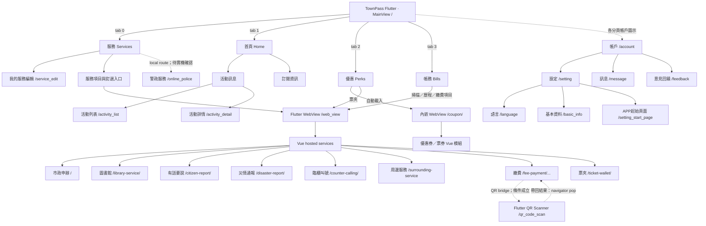
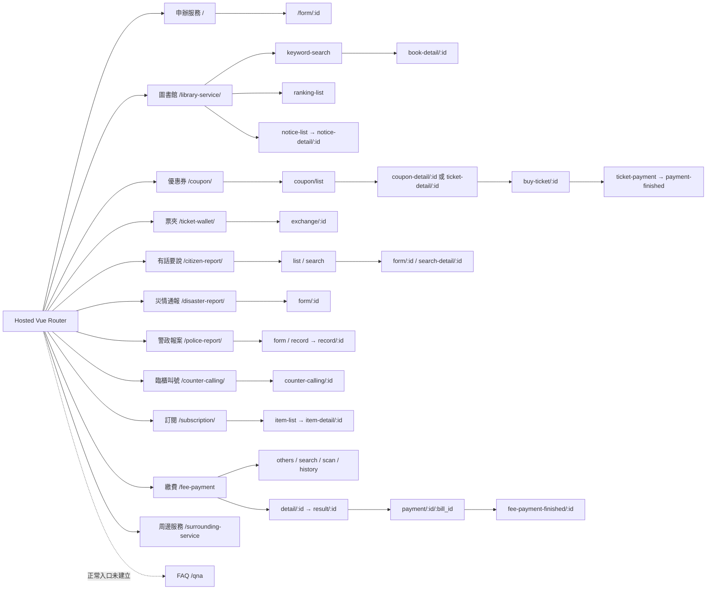

# TownPass — Application Navigation Map / 應用程式地圖

> **完成範圍：** bounded source-level audit。以下是現有程式碼記載的畫面、入口與導航，不是正式部署或實機完整驗證。
> **資料來源：** 此對話上傳的 `APP_FEATURE_REGISTRY(4).json`、`ROUTE_AUDIT_REGISTRY(1).json`、`NAVIGATION_EDGES(1).json`、`UI_CONTROL_REGISTRY(1).json`、`SCREEN_STATE_REGISTRY(1).json` 及 `APP_NAVIGATION(4).md`。

**Audit totals:** 27 feature records · 76 route records (21 Flutter + 55 Vue, including 9 structural parents) · 338 control records · 185 source-reviewed edges · 46 states. Five iPhone paths were reported by the project owner separately.

## 1. Main navigation / 主導航

**注意**：Flutter 底部四個分頁（0 服務、1 首頁、2 優惠、3 帳務）是 `IndexedStack` 分頁，不是獨立 GetX routes。`TPRoute.openUri` 可能開啟 GetX 本機路由或 WebView。

## 2. 27 Feature entry paths / 27 個功能入口

| Area | Feature ID | 中文名稱 | 已知正常入口 |
|---|---|---|---|
| 首頁 | `home` | 首頁 | App startup → 首頁 tab (or select 首頁 from main bottom bar) |
| 首頁 | `activity_information` | 活動訊息 | 首頁 → 活動訊息 → 更多 → activity row, or select an activity banner |
| 首頁 | `subscription` | 訂閱 | 首頁 → 訂閱 設定 or 更多 → hosted WebView; local subscription row opens Flutter detail |
| 服務 | `services` | 服務 | App startup → bottom bar 服務; 我的服務 更多 opens editor |
| 服務 | `service_catalog` | 我的服務 | 服務 → 我的服務 → 更多 or 新增 → 我的服務 editor |
| 服務 | `municipal_applications` | 申辦服務 | 服務 → pinned 申辦服務 → hosted WebView → Vue application home → service item |
| 服務 | `library_services` | 圖書借閱 | 服務 → 我的服務 → 更多 → 圖書借閱 (or pinned library) → hosted WebView |
| 服務 | `online_police` | 警政服務 | 服務 → 警政報案 card attempts local online police route; URI host lacks the registered leading slash and resolution is unverified. |
| 服務 | `citizen_report` | 有話要說 | 服務 → 有話要說 → hosted WebView → report/search tabs and selected category |
| 服務 | `disaster_report` | 災情通報 | 服務 → 我的服務 → 更多 → 災情通報 (or pinned item) → hosted WebView |
| 服務 | `counter_calling` | 臨櫃叫號 | 服務 → 我的服務 → 更多 → 臨櫃叫號 (or pinned item) → hosted WebView |
| 服務 | `surrounding_services` | 周邊服務 | 服務 → 找地點 (pinned or 熱門) → hosted WebView |
| 服務 | `police_report` | 警政報案 | 服務 → 警政報案 attempts local online police route (name resolution unverified); if reached, 網路報案 or 案件查詢 opens hosted WebView. |
| 優惠 | `perks` | 優惠 | Main bottom bar → 優惠; embedded hosted coupon URL loads on WebView creation; 票夾 opens separate WebView |
| 優惠 | `ticket_wallet` | 票夾 | 優惠 → 票夾 → separate hosted WebView → ticket or coupon item |
| 帳務 | `bills` | 帳務 | Main bottom bar → 帳務 → hosted fee item, 掃描 or 紀錄 via separate WebView |
| 帳務 | `qr_scan` | 掃描 QR Code | 帳務 → 掃描 → hosted fee-scan page → qr_code_scan bridge → Flutter scanner |
| 帳務 | `fee_search` | 搜尋繳費項目 | 帳務 → 熱門繳費 其他 → hosted WebView → 搜尋項目名稱 |
| 帳戶 | `account` | 帳戶 | Any main tab → 帳戶 icon |
| 帳戶 | `settings` | 設定 | Any main tab → 帳戶 → 設定 |
| 帳戶 | `language_settings` | 語言 | 首頁 → 帳戶 → 設定 → 語言 |
| 帳戶 | `messages` | 訊息 | 首頁 → 帳戶 → 訊息 → selected message |
| 帳戶 | `personal_information` | 基本資料 | 首頁 → 帳戶 → 設定 → 基本資料 → selected field |
| 帳戶 | `feedback` | 意見回饋 | 首頁 → 帳戶 → 意見回饋 |
| 帳戶 | `startup_page` | APP起始頁面 | 首頁 → 帳戶 → 設定 → APP起始頁面 |
| 帳戶 | `invoice_receipt` | 手機載具 | 首頁 → 帳戶 → 設定 → 手機載具 |
| 未確認 | `faq` | 常見問題 | Normal TownPass UI entry to local Vue /qna is not established in inspected source; /qna categories is linked from the Vue FAQ root. |

## 3. Vue feature route map / Vue 服務地圖

### WebView 邊界

- **Flutter `/web_view`** 是承載外部／託管內容的畫面；Vue 路徑是該網站的 Router 路徑，兩者不是同一套路由。
- **優惠 Perks** 自動嵌入 `/coupon/` 的 WebView；票夾另以 WebView 開啟。
- **帳務 QR** 先進入託管的 Vue 掃描頁，經 bridge 條件式開 Flutter Scanner，結果依導航堆疊返回；不保證固定返回頁面。
- **導航與後端不能混為一談**：優惠券成功、繳費完成、申辦送出等 UI 狀態不證明真實交易。

## 4. Route registry / 完整路由表

Flutter 21 筆：

| Route ID | Registered path | Screen / component | Arguments or path parameters |
|---|---|---|---|
| `flutter.main` | `/` | `flutter.main` | None |
| `flutter.account` | `/account` | `flutter.account` | None |
| `flutter.basicInfo` | `/basic_info` | `flutter.basicInfo` | None |
| `flutter.basicInfoEdit` | `/basic_info_edit` | `flutter.basicInfoEdit` | BasicInfoEditArgument with title and currentValue; optional validator and keyboardType |
| `flutter.feedback` | `/feedback` | `flutter.feedback` | None |
| `flutter.invoiceReceipt` | `/invoice_receipt` | `flutter.invoiceReceipt` | None |
| `flutter.language` | `/language` | `flutter.language` | None |
| `flutter.message` | `/message` | `flutter.message` | None |
| `flutter.messageDetail` | `/message_detail` | `flutter.messageDetail` | MessageItem via Get.arguments |
| `flutter.onlinePolice` | `/online_police` | `flutter.onlinePolice` | None |
| `flutter.phoneCallUserAgreement` | `/phone_call_user_agreement` | `flutter.phoneCallUserAgreement` | None |
| `flutter.portfolioAndAuth` | `/portfolio_and_auth` | `flutter.portfolioAndAuth` | None |
| `flutter.qrCodeScan` | `/qr_code_scan` | `flutter.qrCodeScan` | None |
| `flutter.serviceEdit` | `/service_edit` | `flutter.serviceEdit` | None |
| `flutter.setting` | `/setting` | `flutter.setting` | None |
| `flutter.settingStartPage` | `/setting_start_page` | `flutter.settingStartPage` | None |
| `flutter.subscription` | `/subscription` | `flutter.subscription` | SubscriptionItem via Get.arguments |
| `flutter.suspendAccount` | `/suspend_account` | `flutter.suspendAccount` | None |
| `flutter.webView` | `/web_view` | `flutter.webView` | WebViewArgument optional; usable content needs URL and optional forceTitle |
| `flutter.activityList` | `/activity_list` | `flutter.activityList` | ActivityList via Get.arguments |
| `flutter.activityDetail` | `/activity_detail` | `flutter.activityDetail` | ActivityItem via Get.arguments |

Vue 55 筆（`[structural parent]` 不代表獨立畫面）：

| Route ID | Registered path | Screen / component | Required path variables |
|---|---|---|---|
| `vue.home` | `/` | `vue.HomeView` | — |
| `vue.form` | `/form/:id` | `vue.FormView` | `id` |
| `vue.surrounding-service` | `/surrounding-service` | `vue.SurroundingServiceView` | — |
| `vue.top-qna-list` | `/qna` | `vue.TopQnAListView` | — |
| `vue.qna-list` | `/qna/categories` | `vue.QnAListView` | — |
| `vue.parent:/coupon` | `/coupon` | *[structural parent]* | — |
| `vue.coupon` | `/coupon/` | `vue.CouponView` | — |
| `vue.coupon-list` | `/coupon/list` | `vue.CouponListView` | — |
| `vue.hotspot` | `/coupon/hotspot/:id` | `vue.HotSpotView` | `id` |
| `vue.ticket-detail` | `/coupon/ticket-detail/:id` | `vue.TicketDetail` | `id` |
| `vue.coupon-detail` | `/coupon/coupon-detail/:id` | `vue.CouponDetail` | `id` |
| `vue.buy-ticket` | `/coupon/buy-ticket/:id` | `vue.BuyTicketView` | `id` |
| `vue.ticket-payment` | `/coupon/ticket-payment` | `vue.TicketPayment` | — |
| `vue.payment-finished` | `/coupon/payment-finished` | `vue.PaymentFinishedView` | — |
| `vue.parent:/ticket-wallet` | `/ticket-wallet` | *[structural parent]* | — |
| `vue.ticket-wallet` | `/ticket-wallet/` | `vue.TicketWallet` | — |
| `vue.ticket-exchange` | `/ticket-wallet/exchange/:id` | `vue.TicketExchange` | `id` |
| `vue.parent:/counter-calling` | `/counter-calling` | *[structural parent]* | — |
| `vue.counter-calling` | `/counter-calling/` | `vue.CounterCallingView` | — |
| `vue.counter-calling-detail` | `/counter-calling/:id` | `vue.CounterCallingDetailView` | `id` |
| `vue.parent:/citizen-report` | `/citizen-report` | *[structural parent]* | — |
| `vue.citizen-report` | `/citizen-report/` | `vue.CitizenReportView` | — |
| `vue.citizen-report-list` | `/citizen-report/list` | `vue.CitizenReportListView` | — |
| `vue.citizen-report-form` | `/citizen-report/form/:id` | `vue.CitizenReportFormView` | `id` |
| `vue.citizen-report-search` | `/citizen-report/search` | `vue.CitizenReportSearchView` | — |
| `vue.citizen-report-search-detail` | `/citizen-report/search-detail/:id` | `vue.CitizenReportSearchDetailView` | `id` |
| `vue.parent:/subscription` | `/subscription` | *[structural parent]* | — |
| `vue.subscription` | `/subscription/` | `vue.SubscriptionView` | — |
| `vue.item-list` | `/subscription/item-list` | `vue.SubscriptionItemListView` | — |
| `vue.item-detail` | `/subscription/item-detail/:id` | `vue.SubscriptionItemDetailView` | `id` |
| `vue.parent:/disaster-report` | `/disaster-report` | *[structural parent]* | — |
| `vue.disaster-report` | `/disaster-report/` | `vue.DisasterReportView` | — |
| `vue.disaster-report-form` | `/disaster-report/form/:id` | `vue.DisasterReportFormView` | `id` |
| `vue.parent:/police-report` | `/police-report` | *[structural parent]* | — |
| `vue.police-report` | `/police-report/` | `vue.PoliceReportView` | — |
| `vue.police-report-form` | `/police-report/form` | `vue.PoliceReportFormView` | — |
| `vue.police-report-record` | `/police-report/record` | `vue.PoliceReportRecordView` | — |
| `vue.police-report-record-detail` | `/police-report/record/:id` | `vue.PoliceReportRecordDetailView` | `id` |
| `vue.parent:/library-service` | `/library-service` | *[structural parent]* | — |
| `vue.library-service` | `/library-service/` | `vue.LibraryServiceView` | — |
| `vue.library-keyword-search` | `/library-service/keyword-search` | `vue.LibraryKeywordSearchView` | — |
| `vue.library-ranking-list` | `/library-service/ranking-list` | `vue.LibraryRankingListView` | — |
| `vue.library-book-detail` | `/library-service/book-detail/:id` | `vue.LibraryBookDetailView` | `id` |
| `vue.library-notice-list` | `/library-service/notice-list` | `vue.LibraryNoticeListView` | — |
| `vue.library-notice-detail` | `/library-service/notice-detail/:id` | `vue.LibraryNoticeDetailView` | `id` |
| `vue.fee-payment` | `/fee-payment` | *[structural parent]* | — |
| `vue.fee-payment-others` | `/fee-payment/others` | `vue.FeePaymentOthersView` | — |
| `vue.fee-payment-detail` | `/fee-payment/detail/:id` | `vue.FeePaymentDetailView` | `id` |
| `vue.fee-payment-result` | `/fee-payment/result/:id` | `vue.FeePaymentResultView` | `id` |
| `vue.payment` | `/fee-payment/payment/:id/:bill_id` | `vue.FeePaymentStepView` | `id`, `bill_id` |
| `vue.fee-payment-finished` | `/fee-payment/fee-payment-finished/:id` | `vue.FeePaymentFinishedView` | `id` |
| `vue.fee-payment-search` | `/fee-payment/search` | `vue.FeePaymentSearchView` | — |
| `vue.fee-payment-history` | `/fee-payment/history` | `vue.FeePaymentHistoryView` | — |
| `vue.fee-payment-history-detail` | `/fee-payment/history/:id` | `vue.FeePaymentHistoryDetailView` | `id` |
| `vue.fee-payment-scan` | `/fee-payment/scan` | `vue.FeePaymentScanView` | — |

## 5. Source-level limitations / 原始碼層級的限制

- 活動列表與詳情的 `Get.arguments` 可能在載入期間被傳入 `null`，但接收端要求 typed object。
- 訊息詳情需 `MessageItem`；訂閱詳情需 `SubscriptionItem`；活動列表與詳情分別需要 `ActivityList` 和 `ActivityItem`。
- 服務卡片送出 `local://online_police` 的 host 為 `online_police`，註冊的 Flutter route 卻是 `/online_police`，解析是否成功未知。
- Counter fax 詳情連結未明確附帶必要的 `id`，是否繼承參數未經驗證。
- Flutter WebView 返回、關閉與 TPAppBar 自動返回按鈕的實際目的地依堆疊／瀏覽歷史而定。
- `/portfolio_and_auth` 與 Vue `/qna` 的正常 UI 入口尚未建立。
- 許多服務以 Mock JSON、localStorage 或 in-memory 狀態驅動；託管 WebView 是否對應本次檢查的 Vue 程式碼未知。
- 權限（相機、照片、定位）、付款、核銷、提交、撥打電話等結果未完成實機或服務端驗證。

## 6. Detailed references / 詳細索引

- `APP_FEATURE_REGISTRY.json`：27 個功能、通常入口、Screen／Control／Edge 關聯、相依與限制。
- `UI_CONTROL_REGISTRY.json`：338 筆 source-reviewed 控制項紀錄。
- `NAVIGATION_EDGES.json`：185 條 source-reviewed edge，含前提、參數和動態目的地。
- `ROUTE_AUDIT_REGISTRY.json`：76 筆路由的登錄、參數、來源、入口與可達性限制。
- `SCREEN_STATE_REGISTRY.json`：46 筆 Dialog／非路由狀態。
- `APP_MAP_COVERAGE.md`：完成的審查範圍與已知限制。

**用法：** 若要查某功能，先找 Feature ID → `screen_id` → `related_control_ids` → `related_edge_ids` → 目的 route、params、prerequisites；切勿把 source-reviewed 誤當 runtime-verified。
