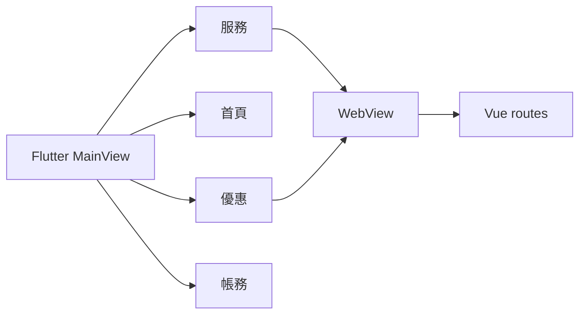
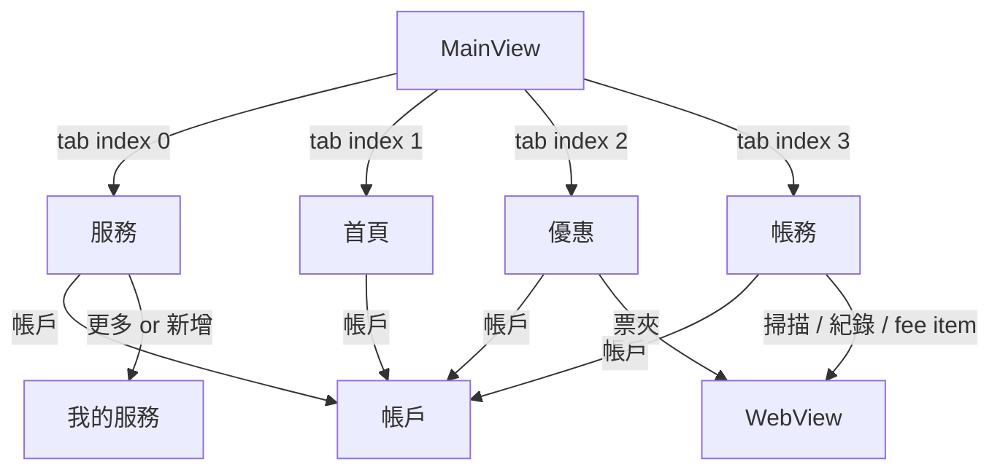
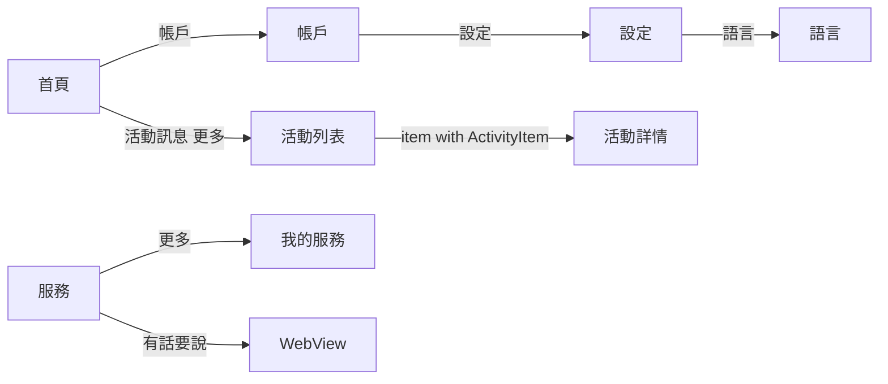
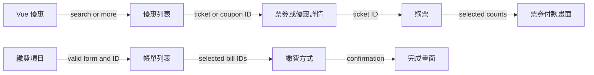
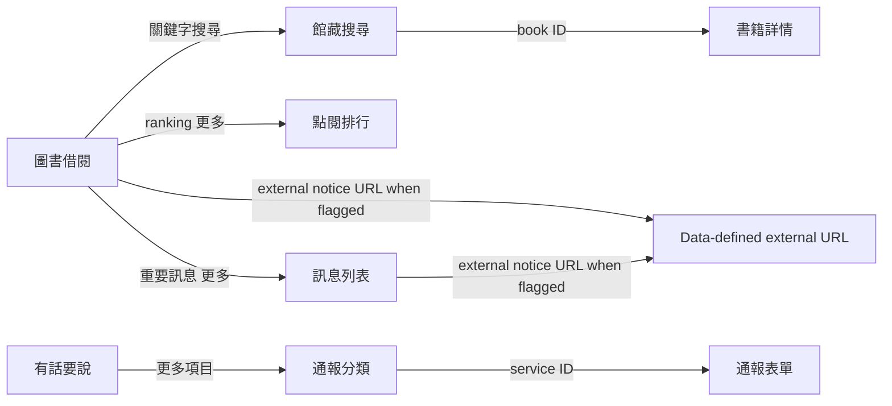
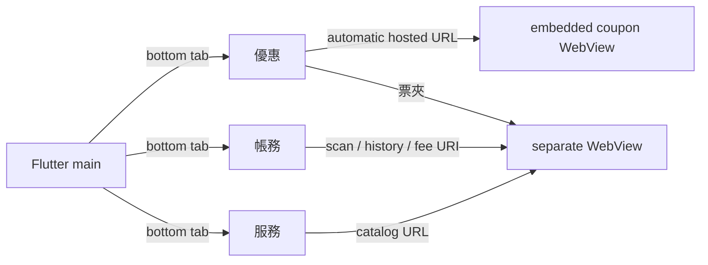
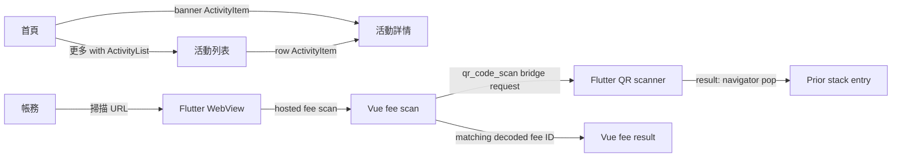
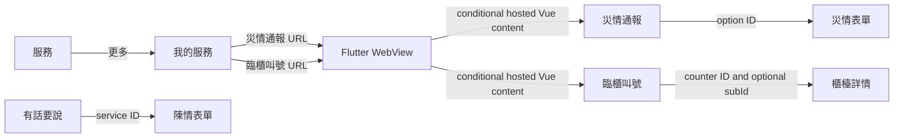

# Navigation — source map

The source index is in SCREEN_INVENTORY.md; the bounded source map and its documented limitations are in APP_MAP_COVERAGE.md. `TownPass/lib/main.dart` starts `TPRoute.main`, whose `GetPage` creates `MainView`. `MainView` uses an indexed stack controlled by `MainViewController`; `tp_bottom_navigation_factory.dart` supplies 服務, 首頁, 優惠, 帳務, defaulting to 首頁 unless a saved index exists. Tabs are not separate registered GetX routes. `TPRoute.home` and `TPRoute.service` are constants but have no corresponding GetPage in the inspected list.

`TPRoute.openUri` dispatches `local` scheme via `Get.toNamed(uri.host)` and otherwise opens `TPWebView` with URL and optional title; the URL is not a safe AI allowlist. The services use Vue Router HTML5 history with nested routes in `TownPass-Services/src/router/index.ts`. Paths containing `:id` or `:bill_id` require path values; store and data dependencies are documented in the route and feature registries. Back behavior and external links can be conditional or history-dependent.

## Ten priority features: traced paths

All direct-route behavior below is **unverified**. The owner reported five UI flows verified on a physical iPhone; see NAVIGATION_TEST_PLAN.md. Previous simulator observations are separate. Feature IDs match APP_FEATURE_REGISTRY.json; Vue paths are relative to the hosted origin, not GetX routes.

| Feature | Normal entry and source | Parameters and dependencies |
|---|---|---|
| home | MainView tab 1, `TownPass/lib/page/main/main_view.dart`, `lib/util/tp_bottom_navigation_factory.dart` | No explicit arguments; saved initial index may override default. |
| services | MainView tab 0; `lib/page/city_service/city_service_view.dart` | No explicit arguments; catalog/pins determine available links. |
| perks | MainView tab 2; `lib/page/perk/perk_view.dart` loads hosted `/coupon/` directly into embedded WebView | No tab arguments; network required. Ticket wallet opens a separate WebView. |
| bills | MainView tab 3; `lib/page/bill/bill_view.dart` | No tab arguments; selected fee link is hosted. |
| account | Account icon in tab app bars → `Get.toNamed(TPRoute.account)`; e.g. `lib/page/home/home_view.dart` | `/account`, no explicit argument. Account data is bundled mock, not proof of authentication. |
| settings | Account's settings icon → `/setting`; `lib/page/account/account_view.dart` | No explicit argument; behavior of authentication in deployments unknown. |
| language_settings | Settings > 語言 → `/language`; `lib/page/setting/setting_view.dart` | No explicit argument. Language selection callback currently empty. |
| activity_information | Home > 活動訊息 > 更多 → `/activity_list`; row or banner → `/activity_detail`; `lib/page/home/widget/activity_info/` | List requires `ActivityList` in Get.arguments; detail requires `ActivityItem`. Bundled mock JSON; images may need network. Loading state can precede list availability. |
| municipal_applications | Services > pinned 申辦服務 (default) → catalog URL → `TPRoute.openUri` → `/web_view` → Vue `/`; `lib/page/city_service/model/my_service_model.dart` and `widget/pinned_service_item_widget.dart` | Hosted network. Selecting a catalog item opens Vue `/form/:id` with an item ID from `public/mock/service_list.json`. `?isSearch` selects the query tab; Vue requests userinfo via bridge. |
| library_services | Services > 我的服務 > 更多 → 圖書借閱 (or pin it) → catalog URL → `/web_view` → Vue `/library-service`; `lib/page/city_service_edit/city_service_edit_view.dart`, `model/my_service_model.dart` | Hosted network; optional `type` query selects tab in `src/views/LibraryServiceView.vue`. Book and notice detail routes require `:id`. Map has empty key in `src/stores/googleMaps.ts`. |

`TPWebView` shows a WebView history back button when `canGoBack`; its close button uses `Get.back()` to return to the Flutter stack (`TownPass/lib/util/tp_web_view.dart`). This differs from Perks' embedded WebView. Actual device back behavior remains pending. Some catalog entries have empty destinations, and `PinnedServiceItemWidget` does not attach an opening callback to those entries. Do not infer all catalog items are functional.

## Further source references and unresolved edges

`SOURCE_EDGE_INDEX.md` records 109 mechanically detected navigation references; these are candidates and are not a validated graph. Additional confirmed argument contracts are in SCREEN_INVENTORY.md. Some UI surfaces are dialogs rather than routes; their candidate declarations are in SOURCE_CONTROL_INDEX.md. Refer to the structured registries for source-reviewed triggers, destinations, dependencies and back behavior. The diagram above is a high-level overview, not a complete graph.

## Reviewed first-module structured edges

`NAVIGATION_EDGES.json` contains the source-reviewed edges; this diagram shows a subset for tab selection, account entry, service editor entry and WebView opening. WebView history back and close have dynamic destinations and are recorded as unresolved rather than assigned an invented target.

Evidence and source lines for each diagram edge are in `NAVIGATION_EDGES.json`. The embedded Perks page is loaded by WebView creation rather than a user click; it is represented by the lifecycle-triggered `perks.embedded_load` edge.

## Account, settings and scanner checkpoint

Account's two settings controls open `flutter.setting` and synchronize account data on return. Account also opens messages, feedback and a FAQ WebView; its history/authorization and subscription callbacks are empty. Settings links to basic info, language, start page, invoice carrier and account suspension. These edges are source-reviewed, not proof of runtime success. Scanner close and successful gallery recognition use `Get.back`; the destination depends on the Flutter stack and the latter returns a decoded string. Registry edges explicitly use `navigator_pop` rather than naming an invented destination. Camera recognition also pops with a result in `qr_code_scan_controller.dart`; its stream-driven `qr.camera_result` edge is recorded.

## Profile, service, and Vue navigation batch

Five basic-information rows pass a `BasicInfoEditArgument` and field-specific validator to `flutter.basicInfoEdit`; confirm returns text using navigator pop, and the caller updates the in-memory mock account. Activity rows, banners, 更多 and message rows pass typed objects to their destinations. In the activity home widgets, `controller.list` or placeholder `activity` may still be null while loading even though destination views expect typed objects; runtime behavior is unverified. Dynamic `openUri` destinations depend on the URI scheme, and pop destinations depend on the stack.

Coupon detail's back button routes to coupon or wallet when the corresponding query is present and otherwise uses browser history. Store-success dialog buttons link to wallet or coupon tabs; library reservation result buttons link to library home or its records tab. Police-record and disaster-category rows pass their item IDs, and fee-payment search uses a router link. Detailed conditional edges and arguments are recorded in `NAVIGATION_EDGES.json`; none implies a verified transaction or reachable entry point.

## Further reviewed paths

The services tab links 有話要說 to a hosted WebView; 警政報案 attempts a local police route whose name resolution is unverified (see correction below). Home subscription settings and list links open hosted pages; a subscription row passes its `SubscriptionItem` to the Flutter detail route. FAQ expands mock questions locally and its more button opens `/qna/categories`. Fee search results, category items, wallet rows and report confirmation buttons have source-backed destinations in the edge registry. The counter detail fax is a link to the *same* named detail route with no explicit parameters, so current-route parameter inheritance and runtime resolution are unverified. The commented-out library-search route in fee search is not a navigation action. Payment completion wording and report success wording are not evidence of real transactions.

## Latest source-review batches

Ticket and fee payment back buttons, ticket-detail back, and ticket-purchase back use `router.back()` and retain history-dependent destinations. A QR bridge response can route to a fee result only after successful base64 JSON decoding and an ID match; the similarly named candidate inside the test block is commented out. Citizen-report list links pass service IDs, and application home links pass selected form IDs. Library searches push the same search route with query parameters; clicking a result passes its book ID. Ticket completion buttons use mock wallet data and a fixed ticket ID; a completion screen does not establish a real transaction. Fee-detail scan routing is invoked from the rendered active tab when its type is not a form.

## Reviewed module paths and dynamic returns

These diagrams illustrate selected source-backed edges, not exhaustive reachability or runtime success. Edge details and conditions are in `NAVIGATION_EDGES.json`.

`webview.history_back` invokes WebView history back only when `canGoBack` is true; `webview.close` pops the Flutter stack. Their destinations depend on history and stack state and are not fixed screen IDs. Direct navigation and device behavior remain unverified.

Messages: 帳戶 → 訊息 → selected `MessageItem` → message detail. A rich-text URL, when present, passes through `TPRoute.openUri` and therefore has a conditional destination. Profile: 設定 → 基本資料 → selected field → editor with `BasicInfoEditArgument`; confirmation pops with text for the caller. Feedback: 帳戶 → 意見回饋; the apparent 有話要說 link and send callback are empty in source. The support-phone link invokes a telephone URI, which was not activated in this audit.

## Main-tab coverage checkpoint

The Perks tab loads `/coupon/` automatically inside its embedded WebView; this is recorded as an external destination because the deployed host's version has not been verified against this checkout. Its ticket-wallet button and the Bills scan, history and popular-fee buttons open separate Flutter WebViews. Conditional catalog and pinned-service links may open a local GetX route, a hosted service URL, or no destination when empty. The linked Vue paths below describe the checked-out router, not proof of deployed equivalence.

Account settings switches use uncontrolled `TPSwitch` local state with no persistence or setting callback; settings history and logout have no provided action. Last-login text is generated from the current time in its controller. No settings, calls, payments or account actions were performed in this audit.

## Activity and scanner paths reviewed

The bridge edge is conditional on the Flutter message handler and the hosted page matching the reviewed code. `Get.back` returns to the actual stack entry, which is not a fixed screen. During activity loading, the list or banner can supply null even though the destination expects a typed argument. The project owner reported the normal activity flow on an iPhone; this audit did not observe it and does not establish direct navigation or all intermediate states.

## Catalog and report routes reviewed

Pinned catalog items can also open the corresponding hosted URLs outside edit mode. Their WebView edges are conditional on the selected item and network, and do not establish that the deployed host uses this checkout. The checked report handlers use local/mock data and success dialogs without demonstrating a real submission. The fee-scan-to-Flutter-scanner bridge and history-dependent scanner return remain recorded separately above.

## Final route review and source-level gaps

A `1999agree` message from the citizen-report view may open the Flutter agreement screen when a telephone handler can launch and saved consent is absent. This transition is conditional and does not mean a call occurred. A WebView `onCloseWindow` event can pop the Flutter stack; the destination is stack-dependent. The QR scanner bridge and return edges remain documented.

Routes with no fixed incoming screen edge include Flutter `main` (app startup), Flutter `portfolioAndAuth` (normal entry not established; account/settings tiles have no callback), and Vue `TopQnAListView` (`/qna`, normal in-app entry not established). Vue surrounding services, counter calling, subscription item list, police record and fee history have hosted-URL source entries through Flutter WebViews, but the graph deliberately does not treat the deployed host as proven identical to this checkout. Vue parent records with no component are routing structure rather than standalone screens.

The bounded source-level graph review has completed; dynamic and conditional behavior remains explicit. The argument-presence validator does not prove that runtime values have the expected type or valid contents.

Semantic audit correction: the services 警政報案 card passes `local://online_police` to `openUri`. The helper forwards the URI host `online_police` to `Get.toNamed`, while the registered route is `/online_police`. Whether GetX resolves that unprefixed name is unverified; the edge now records a conditional destination instead of asserting a fixed screen.

Shared dialog context: `BaseDialog` positive and negative buttons close the model before emitting their respective callbacks; its Headless UI close event resets the model to open. LocationModal is also used by citizen, disaster and police forms; its address confirmation emits to the active parent and closes the location modal. The separate no-result alert is dismissed by its own BaseDialog positive button, not that address confirmation.

Flutter shared app-bar dismissal: null-leading TPAppBar contexts have conditional `shared.flutter_appbar.back.*` edges to a navigator-dependent destination. The framework may infer a back or fullscreen close button when the route implies dismissal and no drawer takes priority; pressing uses `Navigator.maybePop`. Service editor cancels edit on a successful pop. Explicit scanner/WebView leading widgets are separate controls. See APP_MAP_COVERAGE.md for framework version and source limits.

The source-backed notice anchors in the library home and notice list open the data-provided URL when `is_open_outer_link` is true; the structured edges do not assume a fixed target. Notice-detail and subscription-detail descriptions use data-provided `innerHTML`, which can contain links whose destinations and browser handling are not fixed by the views.
